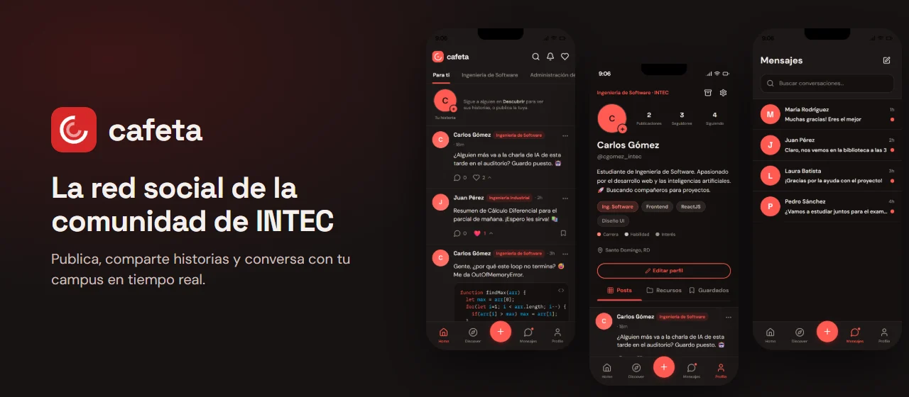
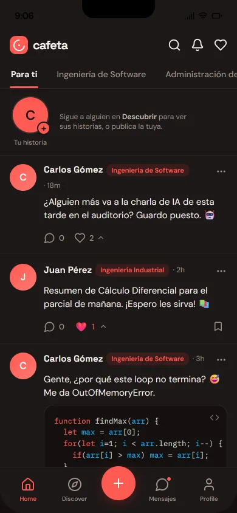
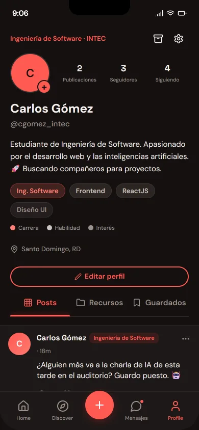
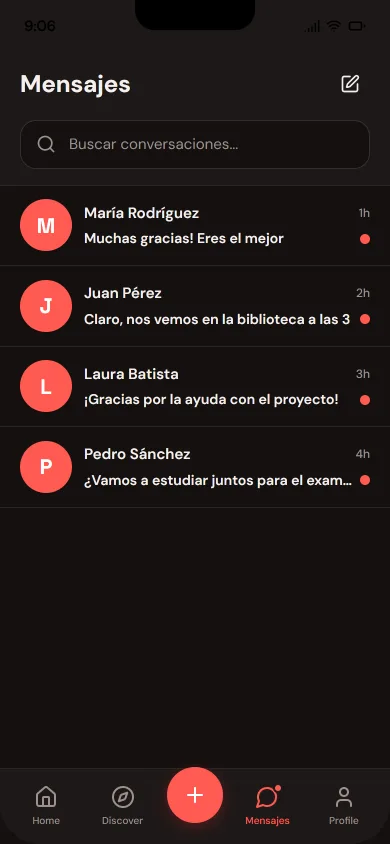
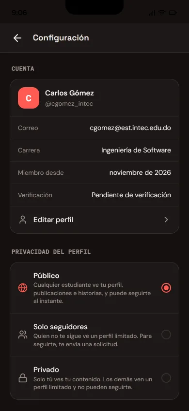

<div align="center">
  <br />
  
  <br />

  <div>


  </div>

  <h3 align="center">Cafeta</h3>

  <p align="center"><a href="https://cafeta-web-hj01.azurewebsites.net">cafeta-web-hj01.azurewebsites.net</a></p>

  <p align="center">La app web de Cafeta, la red social de la comunidad universitaria de INTEC, en República Dominicana.</p>
</div>

## 📋 <a name="table">Tabla de contenido</a>

1. ✨ [Introducción](#introduction)
2. 📸 [Pantallas](#screens)
3. ⚙️ [Stack](#tech-stack)
4. 🔋 [Funciones](#features)
5. 🗂️ [Estructura](#project-structure)
6. 🤸 [Inicio rápido](#quick-start)
7. 🧪 [Pruebas](#tests)
8. 🚀 [Despliegue](#deployment)
9. 🎨 [Dónde cambiar cada cosa](#customization)
10. 🧩 [Los otros repos](#related)
11. 🙌 [Créditos](#credits)
12. 📬 [Contacto](#contact)

## <a name="introduction">✨ Introducción</a>

Cafeta es una red social cerrada para la comunidad de INTEC: solo entra quien tiene un correo institucional. Sus estudiantes comparten apuntes y avisos, suben historias de 24 horas, conversan en tiempo real y descubren a otros compañeros.

Este repositorio es la app del estudiante, pensada como una app de teléfono que corre en el navegador y que se puede instalar. Es una aplicación React que lee todo de [cafeta-api](https://github.com/hjmnz-dev/cafeta-api).

Nació como proyecto académico en INTEC, a partir de un prototipo en Figma, y está desplegada en producción.

## <a name="screens">📸 Pantallas</a>

Capturas con los datos ficticios de la semilla de demo.

<div align="center">
  
  
  
  
</div>

## <a name="tech-stack">⚙️ Stack</a>

- **[React 18](https://react.dev)** y **[TypeScript](https://www.typescriptlang.org)** en modo strict.
- **[Vite 6](https://vite.dev)** para el servidor de desarrollo y el build.
- **[Tailwind CSS 4](https://tailwindcss.com)** con componentes de **[shadcn/ui](https://ui.shadcn.com)** sobre **[Radix UI](https://www.radix-ui.com)**, además de **[MUI](https://mui.com)** y **[Lucide](https://lucide.dev)**.
- **[React Router 7](https://reactrouter.com)** para las rutas y **[React Hook Form](https://react-hook-form.com)** para los formularios.
- **[TanStack Query 5](https://tanstack.com/query)** para los datos de la API, con caché e invalidación por dominio.
- **[Socket.io](https://socket.io)** para mensajes y notificaciones al instante.
- **[Motion](https://motion.dev)** para las animaciones y **[Sonner](https://sonner.emilkowal.ski)** para los avisos.
- **[Sentry](https://sentry.io)** para el monitoreo de errores.
- **[Vitest](https://vitest.dev)** y **[Testing Library](https://testing-library.com)** para las pruebas; **oxlint** y **Prettier** para lint y formato.

## <a name="features">🔋 Funciones</a>

👉 **Solo con correo institucional**: Registro, inicio de sesión con "Recordarme" y recuperación de contraseña por correo.

👉 **Feed por carrera**: La pestaña "Para ti" y una por carrera, con scroll infinito.

👉 **Publicaciones con adjuntos**: Texto con fotos, videos o PDF, y una ubicación del campus si hace falta.

👉 **Reacciones y comentarios**: Cinco reacciones y comentarios editables, también en las historias.

👉 **Historias**: Imagen o video con texto opcional, que duran 24 horas y se pueden editar o desactivar.

👉 **Mensajes en tiempo real**: Conversaciones con edición y retiro de mensajes, y aviso de mensajes nuevos.

👉 **Perfil**: Foto, biografía y etiquetas de carrera, habilidades e intereses, con pestañas de publicaciones, recursos y guardados.

👉 **Tu red**: Seguir usuarios, solicitudes para los perfiles de solo seguidores y bloqueos.

👉 **Búsqueda y descubrir**: Busca personas y publicaciones, y encuentra gente nueva.

👉 **Notificaciones**: Lista con no leídas, preferencias por tipo y avisos al instante.

👉 **Archivar y guardar**: Archiva tus publicaciones para restaurarlas después, y guarda las de otros.

👉 **Privacidad y reportes**: Tres niveles de privacidad del perfil, reportes de usuarios y publicaciones, y desactivación de la cuenta.

👉 **Tema claro y oscuro**: Oscuro por defecto, con cambio desde Configuración.

👉 **Accesible**: Contraste AA comprobado por una prueba, foco visible con teclado, respeto por "reducir movimiento" y campos con etiqueta.

👉 **Instalable**: Trae su manifiesto web para agregarla a la pantalla de inicio.

## <a name="project-structure">🗂️ Estructura</a>

```text
deploy/
└── server.mjs        Servidor estático de producción en App Service
docs/readme/          Imágenes de este README
public/               Iconos y manifiesto web
src/
├── app/
│   ├── components/   Una pantalla por archivo; los componentes base en ui/
│   ├── lib/          Lógica pura, cliente HTTP y tipos generados desde OpenAPI
│   ├── store/        Sesión, tema, tiempo real y hooks de TanStack Query
│   └── routes.tsx    Todas las rutas de la app
├── styles/           Tailwind, fuentes y tokens de color
└── test/             Configuración y utilidades de las pruebas
design.md             Lenguaje visual y reglas de accesibilidad
```

## <a name="quick-start">🤸 Inicio rápido</a>

Sigue estos pasos para correr la app en tu máquina.

**Requisitos**

- [Git](https://git-scm.com/)
- [Node.js](https://nodejs.org/en) 24, con npm
- [cafeta-api](https://github.com/hjmnz-dev/cafeta-api) corriendo en el puerto 3000; su README explica cómo levantarla con datos de demo

**Clonar el repositorio**

```bash
git clone https://github.com/hjmnz-dev/cafeta-app.git
cd cafeta-app
```

**Instalación**

```bash
npm install
```

**Correr el proyecto**

```bash
npm run dev
```

Abre [http://localhost:5173](http://localhost:5173) en tu navegador.

Con la semilla de la API puedes entrar como `cgomez@est.intec.edu.do`, con la `SEED_DEMO_PASSWORD` de tu `.env` de la API.

**Variables de entorno**

No necesitas ninguna en local: sin `VITE_API_URL`, la app usa `http://localhost:3000/api/v1`, y sin `VITE_SENTRY_DSN` no envía nada a Sentry. Las dos están explicadas en [`.env.example`](.env.example).

## <a name="tests">🧪 Pruebas</a>

```bash
npm test              # pruebas con Vitest y Testing Library
npm run lint          # revisa todo el repo y falla con cualquier aviso
npm run format:check  # revisa el formato
npm run typecheck     # revisa los tipos
npm run api:types     # regenera los tipos desde OpenAPI, con la API en el puerto 3000
```

Husky y lint-staged revisan lint, formato y tipos antes de cada commit, y el CI repite todo en cada push y en cada PR.

## <a name="deployment">🚀 Despliegue</a>

La app corre en [cafeta-web-hj01.azurewebsites.net](https://cafeta-web-hj01.azurewebsites.net), en [Azure App Service](https://azure.microsoft.com/products/app-service) (Canada Central). Cada push a `main` corre el CI y, solo si todo pasa, el job `deploy`:

1. Compila con la URL de la API y el DSN de Sentry del ambiente `production`.
2. Sube los source maps a Sentry y comprueba que ninguno quede publicado.
3. Entra a Azure con OIDC, sin contraseñas guardadas en GitHub, y sube `dist/` con `deploy/server.mjs`.
4. Espera a que `/version.txt` muestre el commit nuevo.

Las demás ramas y los PR nunca despliegan. Cuando un cambio toca el contrato, primero se despliega la API.

## <a name="customization">🎨 Dónde cambiar cada cosa</a>

| Para cambiar           | Edita                                                                 |
| ---------------------- | --------------------------------------------------------------------- |
| Rutas                  | `src/app/routes.tsx`                                                  |
| Colores y tema         | `src/styles/theme.css`, con las reglas en `design.md`                 |
| Mensajes de error      | `src/app/lib/error-messages.ts`                                       |
| Términos y privacidad  | `src/app/lib/legal.ts`                                                |
| Ubicaciones del campus | `src/app/lib/campus-locations.ts`                                     |
| Claves de caché        | `src/app/lib/query-keys.ts`                                           |
| Tipos de la API        | `npm run api:types`; `src/app/lib/api-types.ts` nunca se edita a mano |

## <a name="related">🧩 Los otros repos</a>

Cafeta son tres repositorios que se despliegan por separado:

- **[cafeta-api](https://github.com/hjmnz-dev/cafeta-api)**: la API.
- **[cafeta-app](https://github.com/hjmnz-dev/cafeta-app)**: esta app web.
- **[cafeta-admin-web](https://github.com/hjmnz-dev/cafeta-admin-web)**: la consola de administración.

## <a name="credits">🙌 Créditos</a>

- **Componentes base**: [shadcn/ui](https://ui.shadcn.com), con [licencia MIT](https://github.com/shadcn-ui/ui/blob/main/LICENSE.md). Más detalle en [ATTRIBUTIONS.md](ATTRIBUTIONS.md).

## <a name="contact">📬 Contacto</a>

**Hamsell Jiménez**

- [GitHub](https://github.com/hjmnz-dev)
- [LinkedIn](https://www.linkedin.com/in/hamselljimenez)
- [hamselljimenez@gmail.com](mailto:hamselljimenez@gmail.com)
