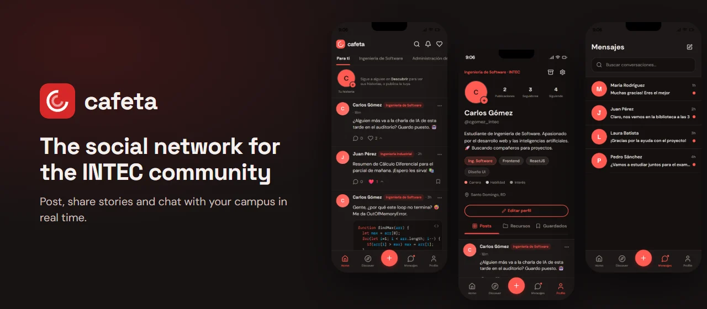

<div align="center">
  <br />
  
  <br />

  <div>


  </div>

  <h3 align="center">Cafeta</h3>

  <p align="center"><a href="https://cafeta-web-hj01.azurewebsites.net">cafeta-web-hj01.azurewebsites.net</a></p>

  <p align="center">The web app of Cafeta, the social network for the INTEC university community in the Dominican Republic.</p>

  <p align="center"><b>English</b> · <a href="README.es.md">Español</a></p>
</div>

## 📋 <a name="table">Table of Contents</a>

1. ✨ [Introduction](#introduction)
2. 📸 [Screens](#screens)
3. ⚙️ [Tech Stack](#tech-stack)
4. 🔋 [Features](#features)
5. 🗂️ [Project Structure](#project-structure)
6. 🤸 [Quick Start](#quick-start)
7. 🧪 [Tests](#tests)
8. 🚀 [Deployment](#deployment)
9. 🎨 [Customization](#customization)
10. 🧩 [Related Repos](#related)
11. 🙌 [Credits](#credits)
12. 📬 [Contact](#contact)

## <a name="introduction">✨ Introduction</a>

Cafeta is a closed social network for the INTEC community: only people with an institutional email can join. Students share notes and announcements, post 24-hour stories, chat in real time and discover other classmates.

This repository is the student app, designed as a phone app that runs in the browser and can be installed. It is a React application that reads everything from [cafeta-api](https://github.com/hjmnz-dev/cafeta-api).

It started as an academic project at INTEC, from a Figma prototype, and runs in production. The interface is in Spanish, the language of its users.

## <a name="screens">📸 Screens</a>

Screenshots with the fictional data from the demo seed.

<div align="center">
  
  
  
  
</div>

## <a name="tech-stack">⚙️ Tech Stack</a>

- **[React 18](https://react.dev)** and **[TypeScript](https://www.typescriptlang.org)** in strict mode.
- **[Vite 6](https://vite.dev)** for the development server and production build.
- **[Tailwind CSS 4](https://tailwindcss.com)** with **[shadcn/ui](https://ui.shadcn.com)** components on **[Radix UI](https://www.radix-ui.com)**, plus **[MUI](https://mui.com)** and **[Lucide](https://lucide.dev)**.
- **[React Router 7](https://reactrouter.com)** for routing and **[React Hook Form](https://react-hook-form.com)** for forms.
- **[TanStack Query 5](https://tanstack.com/query)** for API data, with caching and per-domain invalidation.
- **[Socket.io](https://socket.io)** for instant messages and notifications.
- **[Motion](https://motion.dev)** for animations and **[Sonner](https://sonner.emilkowal.ski)** for toasts.
- **[Sentry](https://sentry.io)** for error monitoring.
- **[Vitest](https://vitest.dev)** and **[Testing Library](https://testing-library.com)** for tests; **oxlint** and **Prettier** for linting and formatting.

## <a name="features">🔋 Features</a>

👉 **Institutional Email Only**: Sign-up, sign-in with "Remember me" and password recovery by email.

👉 **Feed by Degree Program**: A "For you" tab plus one tab per program, with infinite scroll.

👉 **Posts with Attachments**: Text with photos, videos or PDFs, and an optional campus location.

👉 **Reactions and Comments**: Five reactions and editable comments, on stories too.

👉 **Stories**: An image or video with optional text, lasting 24 hours, that can be edited or deactivated.

👉 **Real-Time Messages**: Conversations with message editing and withdrawal, and alerts for new messages.

👉 **Profile**: Photo, bio and tags for program, skills and interests, with tabs for posts, resources and saved items.

👉 **Your Network**: Follow users, follow requests for followers-only profiles, and blocks.

👉 **Search and Discover**: Search people and posts, and find new people.

👉 **Notifications**: A list with unread items, preferences by type and instant alerts.

👉 **Archive and Save**: Archive your posts to restore them later, and save other people's posts.

👉 **Privacy and Reports**: Three profile privacy levels, reports on users and posts, and account deactivation.

👉 **Light and Dark Themes**: Dark by default, switchable from Settings.

👉 **Accessible**: AA contrast checked by a test, visible keyboard focus, support for "reduce motion" and labeled fields.

👉 **Installable**: Ships a web manifest so it can be added to the home screen.

## <a name="project-structure">🗂️ Project Structure</a>

```text
deploy/
└── server.mjs        Production static server on App Service
docs/readme/          Images for this README
public/               Icons and web manifest
src/
├── app/
│   ├── components/   One screen per file; base components in ui/
│   ├── lib/          Pure logic, HTTP client and types generated from OpenAPI
│   ├── store/        Session, theme, real time and TanStack Query hooks
│   └── routes.tsx    Every route in the app
├── styles/           Tailwind, fonts and color tokens
└── test/             Test setup and utilities
design.md             Visual language and accessibility rules
```

## <a name="quick-start">🤸 Quick Start</a>

Follow these steps to run the app on your machine.

**Prerequisites**

- [Git](https://git-scm.com/)
- [Node.js](https://nodejs.org/en) 24, with npm
- [cafeta-api](https://github.com/hjmnz-dev/cafeta-api) running on port 3000; its README explains how to start it with demo data

**Cloning the Repository**

```bash
git clone https://github.com/hjmnz-dev/cafeta-app.git
cd cafeta-app
```

**Installation**

```bash
npm install
```

**Running the Project**

```bash
npm run dev
```

Open [http://localhost:5173](http://localhost:5173) in your browser.

With the API's demo seed you can sign in as `cgomez@est.intec.edu.do`, using the `SEED_DEMO_PASSWORD` from the API's `.env`.

**Environment Variables**

None are needed locally: without `VITE_API_URL`, the app uses `http://localhost:3000/api/v1`, and without `VITE_SENTRY_DSN` it sends nothing to Sentry. Both are explained in [`.env.example`](.env.example).

## <a name="tests">🧪 Tests</a>

```bash
npm test              # tests with Vitest and Testing Library
npm run lint          # checks the whole repo and fails on any warning
npm run format:check  # checks formatting
npm run typecheck     # checks types
npm run api:types     # regenerates the types from OpenAPI, with the API on port 3000
```

Husky and lint-staged check linting, formatting and types before every commit, and CI runs everything again on every push and pull request.

## <a name="deployment">🚀 Deployment</a>

The app runs at [cafeta-web-hj01.azurewebsites.net](https://cafeta-web-hj01.azurewebsites.net), on [Azure App Service](https://azure.microsoft.com/products/app-service) (Canada Central). Every push to `main` runs CI and, only if everything passes, the `deploy` job:

1. Builds with the API URL and Sentry DSN from the `production` environment.
2. Uploads the source maps to Sentry and checks that none get published.
3. Signs in to Azure with OIDC, with no passwords stored in GitHub, and uploads `dist/` with `deploy/server.mjs`.
4. Waits until `/version.txt` shows the new commit.

Other branches and pull requests never deploy. When a change touches the contract, the API deploys first.

## <a name="customization">🎨 Customization</a>

| To change         | Edit                                                               |
| ----------------- | ------------------------------------------------------------------ |
| Routes            | `src/app/routes.tsx`                                               |
| Colors and theme  | `src/styles/theme.css`, following the rules in `design.md`         |
| Error messages    | `src/app/lib/error-messages.ts`                                    |
| Terms and privacy | `src/app/lib/legal.ts`                                             |
| Campus locations  | `src/app/lib/campus-locations.ts`                                  |
| Cache keys        | `src/app/lib/query-keys.ts`                                        |
| API types         | `npm run api:types`; never edit `src/app/lib/api-types.ts` by hand |

## <a name="related">🧩 Related Repos</a>

Cafeta is made of three repositories that deploy separately:

- **[cafeta-api](https://github.com/hjmnz-dev/cafeta-api)**: the API.
- **[cafeta-app](https://github.com/hjmnz-dev/cafeta-app)**: this web app.
- **[cafeta-admin-web](https://github.com/hjmnz-dev/cafeta-admin-web)**: the admin console.

## <a name="credits">🙌 Credits</a>

- **Base components**: [shadcn/ui](https://ui.shadcn.com), under the [MIT license](https://github.com/shadcn-ui/ui/blob/main/LICENSE.md). More details in [ATTRIBUTIONS.md](ATTRIBUTIONS.md) (in Spanish).

## <a name="contact">📬 Contact</a>

**Hamsell Jiménez**

- [GitHub](https://github.com/hjmnz-dev)
- [LinkedIn](https://www.linkedin.com/in/hamselljimenez)
- [hamselljimenez@gmail.com](mailto:hamselljimenez@gmail.com)
